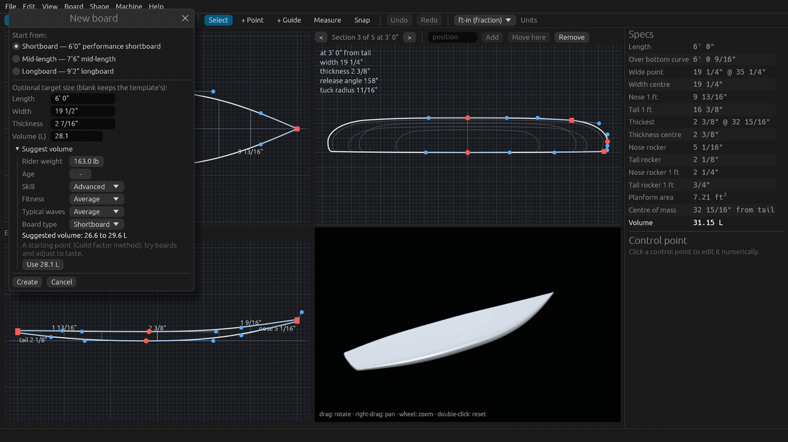
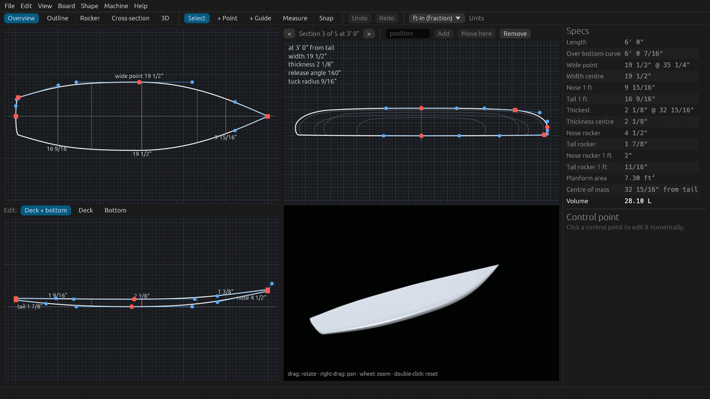
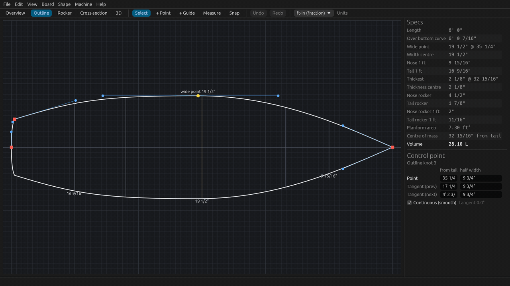
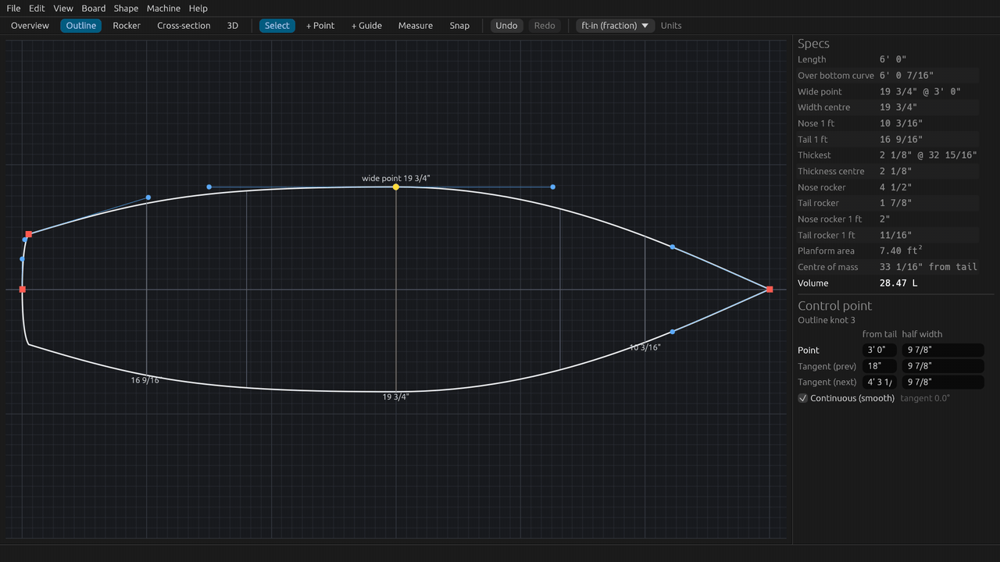
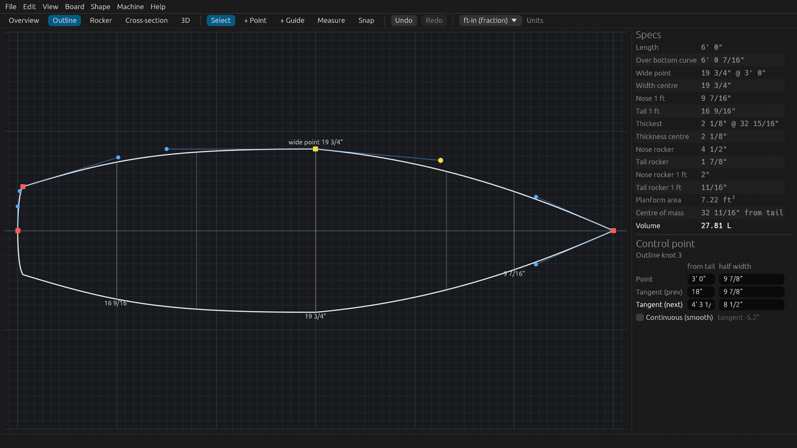
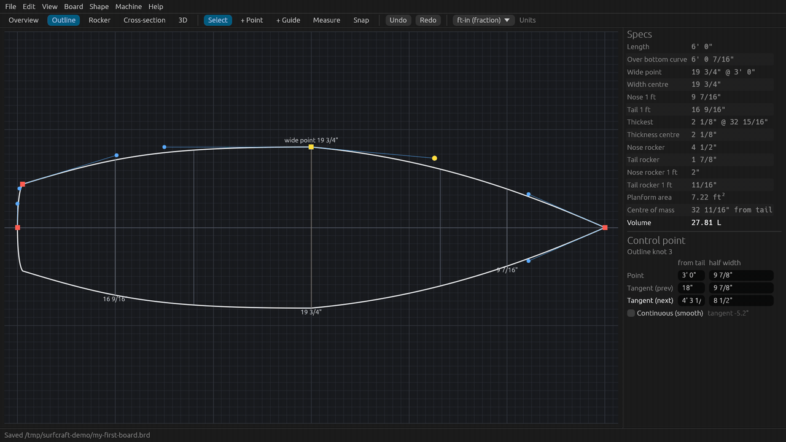

# Tutorial 1: Your first board

Start a new board from a template at the size you want, let SurfCraft suggest the volume, then shape the outline:
select, drag, fine drag, type exact values, smooth, undo and save. About 10 minutes, or watch the 2-minute video
(`SurfCraft-tutorial-01-first-board.mp4` on the [Releases page](https://github.com/sseveur/surfcraft/releases)).

The screenshots use feet and inches; every value can also be typed in centimetres (`47cm`) or millimetres.

## 1. Start from a template at your size

1. **File > New…** (Ctrl+N, Cmd+N on a Mac).
2. Under **Start from**, keep **Shortboard — 6'0" performance shortboard**.
3. Type the target size. Each field accepts feet and inches with fractions:
   - **Length** `6'0"`
   - **Width** `19 1/2"`
   - **Thickness** `2 7/16"`

   Leave a field as it is to keep the template's value.

## 2. Let SurfCraft suggest the volume

1. Click **Suggest volume** under the size fields.
2. Set the **Rider weight** (drag the value sideways, or click it and type), then the **Skill**, **Fitness**,
   **Typical waves** and **Board type**. The age is optional.
3. The suggested range appears below (here 26.6 to 29.6 L for a 163 lb advanced surfer on a shortboard). Click
   **Use 28.1 L** to put the middle of the range into **Volume (L)**.

The suggestion is a starting point (the Guild factor method), not a rule: adjust it to how the rider surfs.

## 3. Create the board

Click **Create**. SurfCraft scales the template to your length and width, then adjusts the thickness so the board
has exactly the target volume. The **Specs** panel on the right shows the result: length, widths, thickness, rocker,
area, centre of mass and **Volume 28.10 L**. The specs update live with every change you make.

## 4. Select a point

Open the **Outline** tab and click a control point (the red dots and squares on the curve; squares are corners).
The selected point turns yellow and the **Control point** panel shows where it is: its distance from the tail and its
half width, and the same for its two tangent handles (the blue dots on the thin lines).

Scroll to zoom in at the pointer, drag with the right button to pan, and press **F** to fit the whole board again.

## 5. Drag it

- **Drag** the point to move it; the curve, the width and the volume follow.
- Hold **Alt** (Option on a Mac) while dragging for a move ten times finer, for the last 1/16".
- Drag a **tangent handle** to change the direction and fullness of the curve through the point.

Every drag is one undo step.

## 6. Type exact values

Click a field in the **Control point** panel, type a value and press Enter. In the tutorial the wide point is put
3 feet from the tail (`3'`) with a half width of `9 7/8"`, so the board is 19 3/4" wide there. Values can be typed
as `3'`, `36"`, `2' 11 1/2"`, `91.4cm` or `914mm`.

## 7. Corners and smoothing

A point is **Continuous (smooth)** by default: its two handles stay in line, so the curve has no corner. Untick it
and you can drag one handle on its own, which puts a corner (a kink) in the curve, as at a squash tail.

**Edit > Smooth kinks in this curve** lines up the handles of every point with an accidental kink in the curve
(deliberate corners such as the tail are kept). **Edit > Smooth selected points** smooths just the points you
selected, corners included.

## 8. Undo and redo

Made a mistake? **Undo** and **Redo** are in the toolbar and in the Edit menu, or press **Ctrl+Z** and
**Ctrl+Shift+Z** (Cmd+Z and Cmd+Shift+Z on a Mac). Each drag, typed value or menu command is one step.

## 9. Save

**File > Save** (Ctrl+S) asks for a name the first time. Boards are saved as BoardCAD `.brd` files, so they also
open in BoardCAD and in other programs that read the format. When you save over an existing file, the previous
version is kept next to it as `.brd.bak`.

## Next

[Tutorial 2: rocker and cross-sections](02-rocker-and-sections.md): bottom contours and rails.
