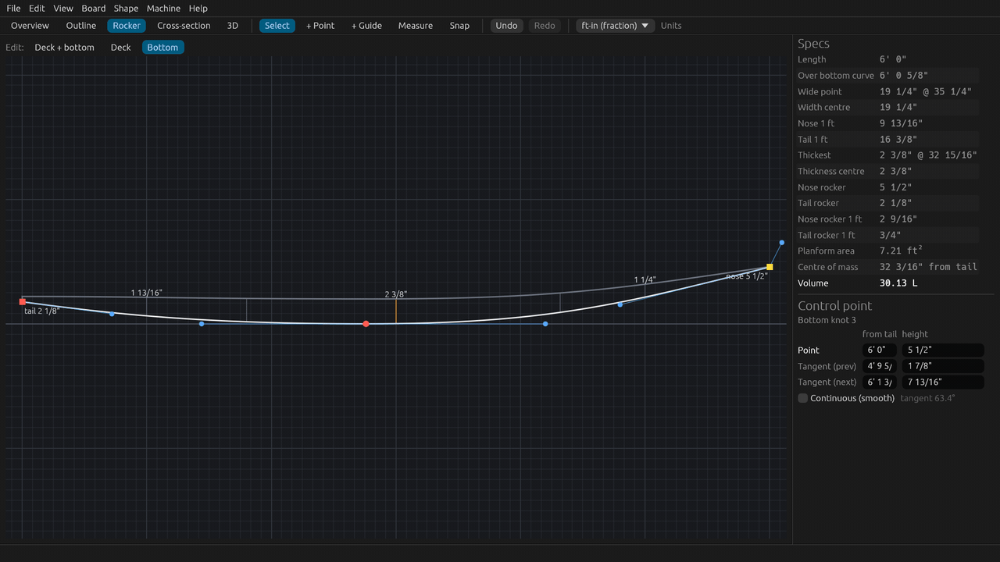
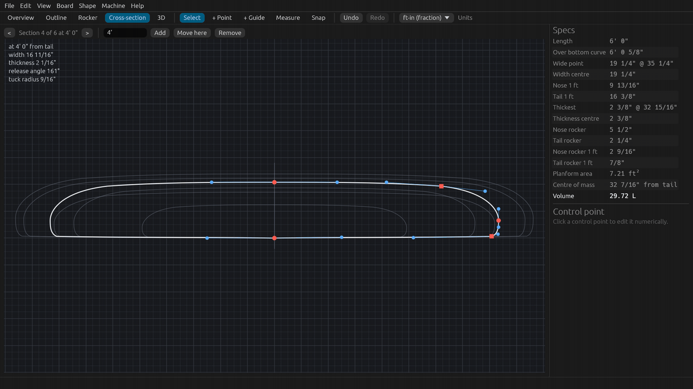
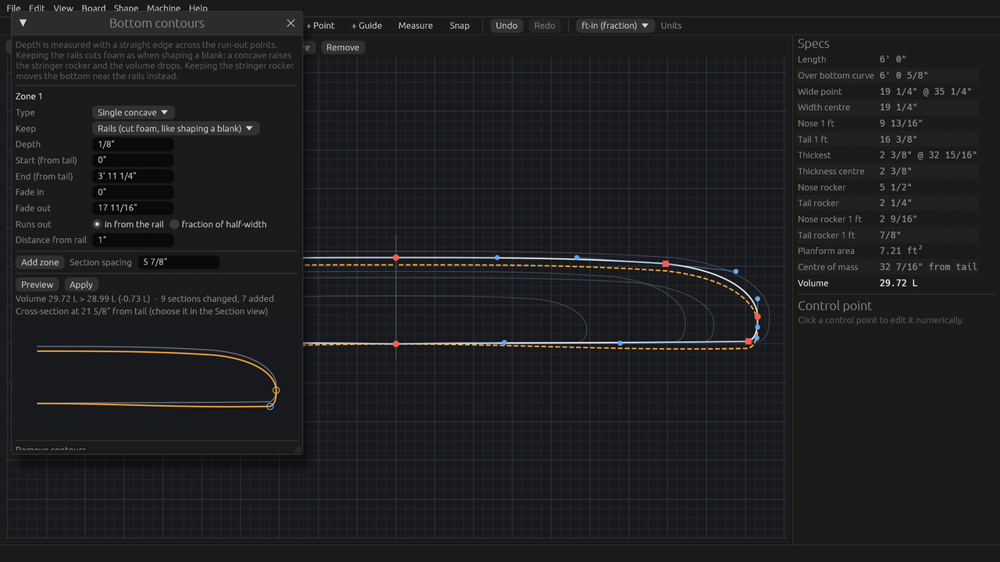
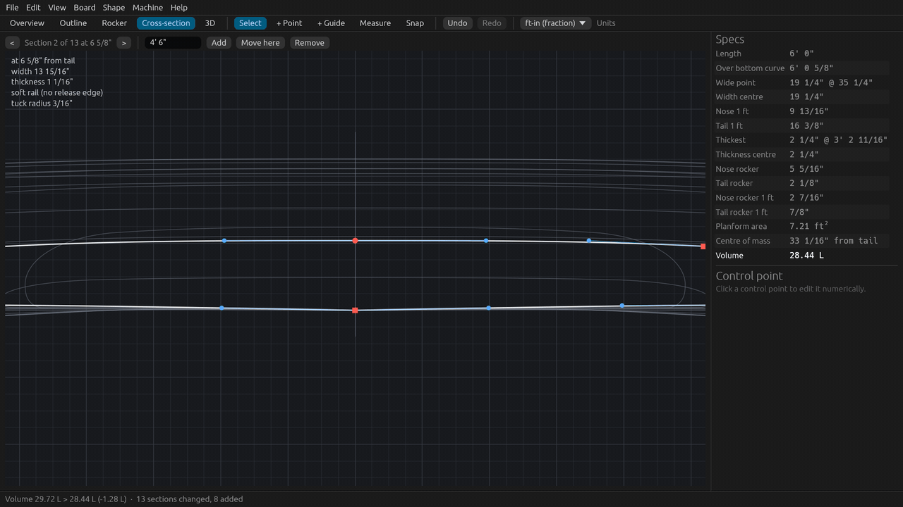
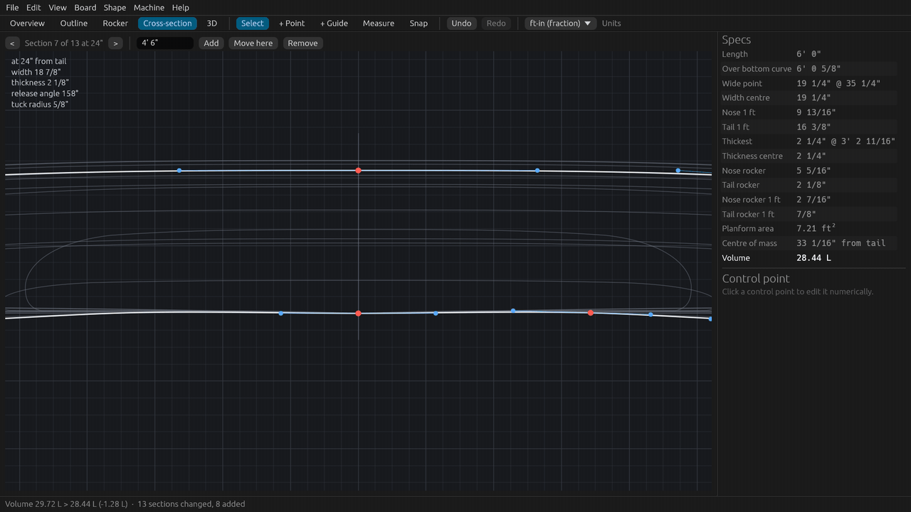
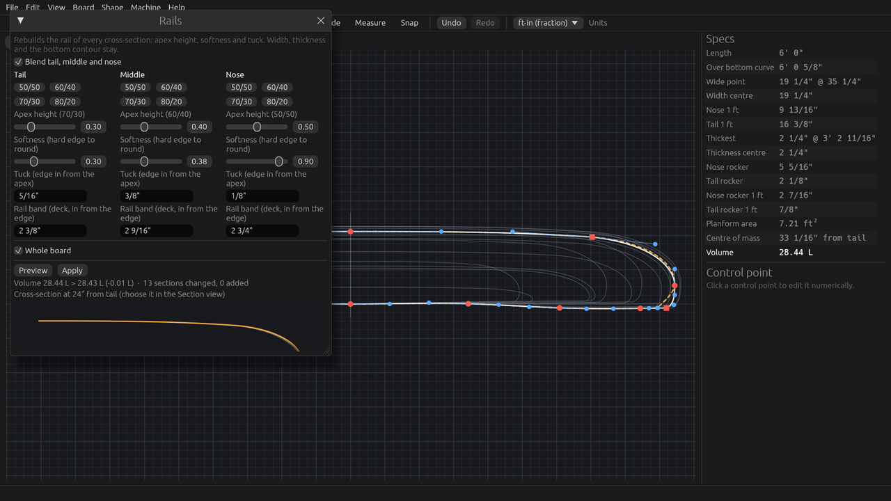

# Tutorial 2: Rocker and cross-sections

Shape the rocker, place the cross-sections, then add bottom contours (single concave, double concave, vee) and
rails with the Shape menu. About 15 minutes, or watch the 2.5-minute video
(`SurfCraft-tutorial-02-rocker-and-sections.mp4` on the [Releases page](https://github.com/sseveur/surfcraft/releases)).

The tutorial uses the built-in 6'0" shortboard that SurfCraft opens with. The screenshots use feet and inches; every
value can also be typed in centimetres (`47cm`) or millimetres.

## 1. Edit the rocker

Open the **Rocker** tab. It shows the board from the side: the deck on top, the bottom (the rocker) below, with the
thickness at a few stations and the nose and tail rocker written at the ends.

The **Edit:** buttons above the view choose which curve you work on:

- **Deck + bottom**: points on both curves can be grabbed.
- **Deck**: only the deck. The bottom turns grey and stays where it is.
- **Bottom**: only the bottom, so you cannot move the deck by mistake.

Choose **Bottom** and drag the nose point (the last point, on the right) up. The **Nose rocker** value in the
**Specs** panel follows as you drag. Lift the tail point a little for more **Tail rocker**: more tail rocker makes a
board looser, less makes it faster and straighter. **Nose rocker 1 ft** and **Tail rocker 1 ft** give the rocker one
foot in from each end, which is where most shapers compare boards.

Choose **Deck** to shape the deck line, for example to take thickness out of the nose. As in the Outline view, click a
point to see and type its values in the **Control point** panel, and hold **Alt** (Option on a Mac) for a fine drag.
After a rocker edit, SurfCraft keeps the lowest point of the bottom at zero.

## 2. Step through the cross-sections

Open the **Cross-section** tab. It shows one section at a time, at full width, with the other sections in grey behind
it. The label at the top says which section you see and where it is, for example **Section 4 of 6 at 4' 0"**. The panel at the top
left gives its width, thickness, rail release angle and tuck radius.

- **<** and **>** (or the **-** and **+** keys) go to the previous and next section.
- In the Outline or Rocker view, double-click near a section line to jump to that section.

## 3. Add, move and remove a section

1. Type a distance from the tail in the **position** field next to the arrows, for example `4'`.
2. Click **Add**. The new section is fitted to the outline and the rocker at that position, and becomes the current
   one.

- **Move here** moves the current section to the typed position (type `4' 6"`, then click **Move here**).
- **Remove** deletes the current section.

Each of these is one undo step. More sections give you more control over the shape, but every section is one more
curve to keep fair: add them where the shape changes, such as at the start and end of a concave.

## 4. Single concave: Shape > Bottom contours

Go to a section in the tail half (here 21 5/8" from the tail), then open **Shape > Bottom contours…**. The window
starts with one zone:

- **Type: Single concave**, **Depth** 1/8", from the tail (**Start** 0") to **End** 3' 11 1/4", fading out over
  the last 17 11/16" (**Fade out**).
- **Keep: Rails (cut foam, like shaping a blank)**. The rail edge stays where it is and foam is cut away, as when you
  shape a concave into a blank: the stringer rocker rises by the depth and the volume goes down. The other choice,
  **Stringer rocker**, keeps the stringer and moves the bottom down near the rails instead, which adds volume.
- **Runs out** 1" **in from the rail**: where the concave ends, short of the rail. The depth is measured with a
  straight edge across the two run-out points.

Click **Preview**. The new bottom is drawn dashed in the Section view and in colour in the window, over the current
section in grey, and the window shows what it costs: **Volume 29.72 L > 28.99 L (-0.73 L)**. **Apply** changes the
board, as one undo step.

Changed your mind? **Undo** (Ctrl+Z, Cmd+Z on a Mac) puts the flat bottom back.

## 5. Double concave and vee in the tail

A typical shortboard bottom has a single concave under the front foot, a double concave through the fins and a vee off
the tail. Zones do this: each zone is a contour over a range, and where zones overlap, the later one blends over the
earlier one.

1. In **Zone 1**, set **Type** to **Double concave (inside a single)**: two shallow concaves (**Inner concave
   depth**, 1/16") inside the single.
2. Click **Add zone**. Scroll down to **Zone 2**, set its **Type** to **Vee** and its **End** to `1' 6"`. It fades
   out over the last 10 13/16", into the double concave.
3. **Preview**, then **Apply**. Here the volume goes down by 1.28 L.

Close the window and zoom in on the bottom in the Section view (scroll at the stringer). Near the tail, the bottom
has a vee: it is highest at the stringer and runs down to the rails.

Further up, under the front foot, the double concave: two shallow hollows on either side of the stringer.

Press **F** to fit the section again. **Channels** work the same way, with a number of channels per side and their
width. **Remove contours** at the bottom of the window flattens the bottom again over a range.

## 6. Rails: Shape > Rails

**Shape > Rails…** rebuilds the rail of every cross-section. The width, the thickness and the bottom contour stay.

- The presets **50/50**, **60/40**, **70/30** and **80/20** set the apex height: where the rail is widest, as a
  fraction of the rail height from the bottom. 50/50 is a full, round rail (older longboards); 60/40 is the usual
  shortboard rail; 70/30 and 80/20 are lower and harder.
- **Softness (hard edge to round)**: from 0, a hard release edge at the bottom, to 1, a fully rounded rail.
- **Tuck (edge in from the apex)**: how far the bottom edge sits inboard of the apex. Here `3/8"`.
- **Rail band (deck, in from the edge)**: how far in from the edge the rail meets the deck.

Tick **Blend tail, middle and nose** to give each part of the board its own rail. The window then has three columns,
**Tail**, **Middle** and **Nose**, and the rail blends smoothly from one to the next: here 70/30 with a harder edge in
the tail for release, the 60/40 in the middle, and a soft 50/50 in the nose. Untick **Whole board** to shape only a
range of the board.

**Preview** and **Apply** work as in the Bottom contours window.

## 7. Undo

Every Shape command, every section added, moved or removed, and every drag is one undo step. **Undo** and **Redo** are
in the toolbar and in the Edit menu, or press **Ctrl+Z** and **Ctrl+Shift+Z** (Cmd+Z and Cmd+Shift+Z on a Mac).

## Next

[Tutorial 3: fins and print templates](03-fins-and-print.md): fin setups and boxes, and full-size templates on paper.
Back to [Tutorial 1: your first board](01-first-board.md).
