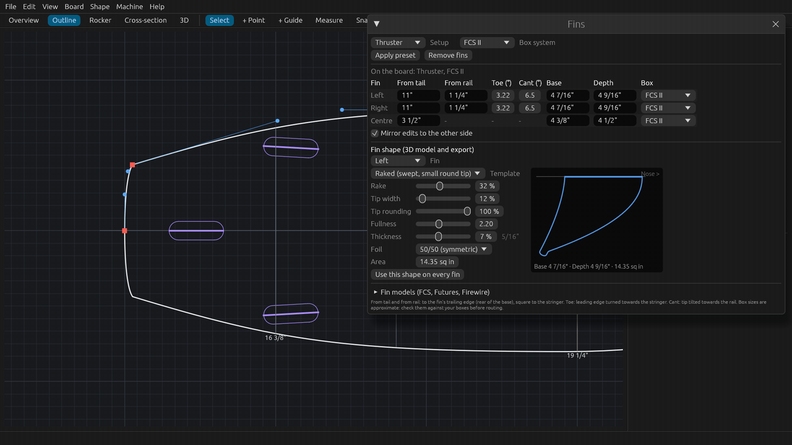
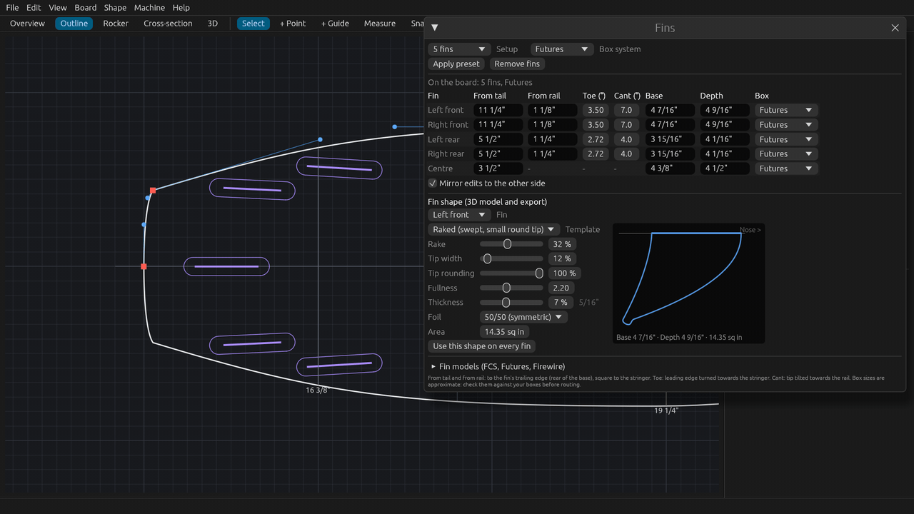
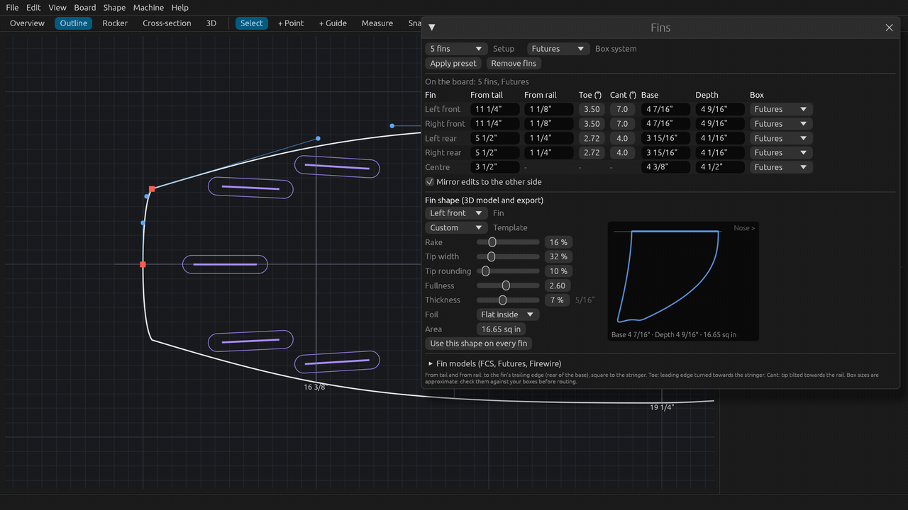
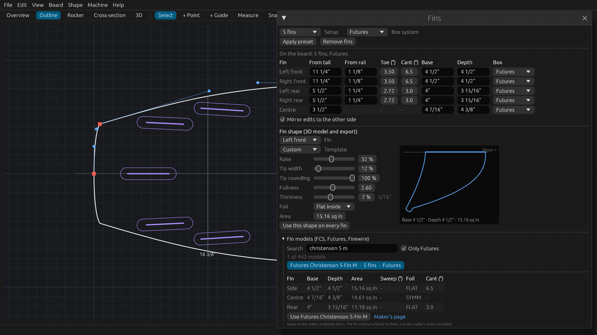
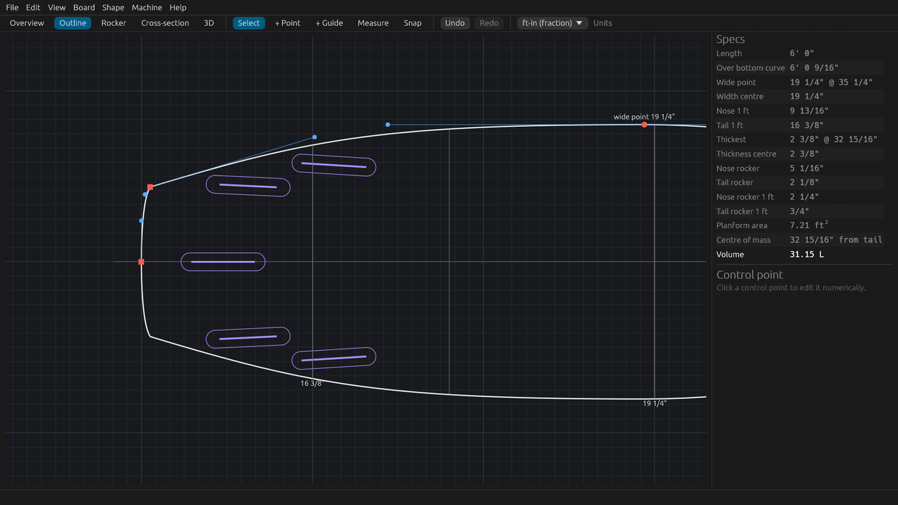
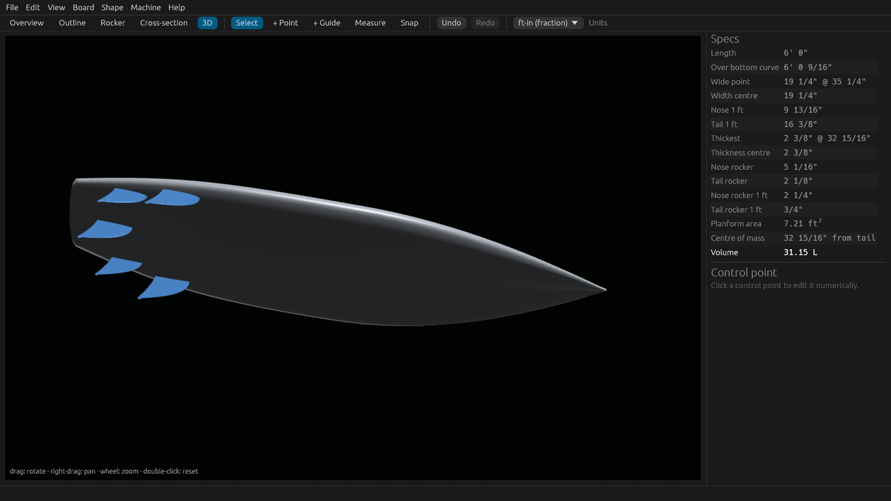
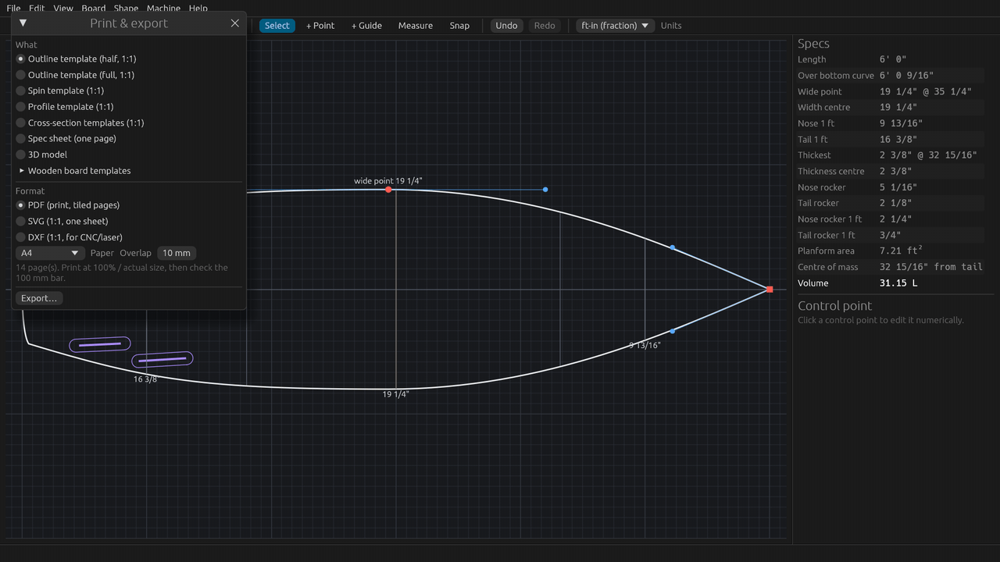
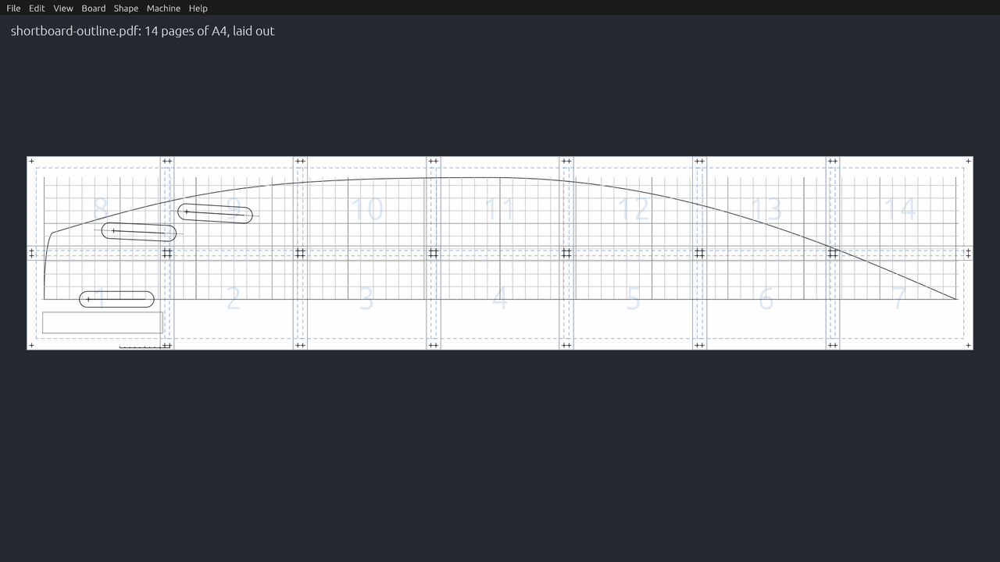
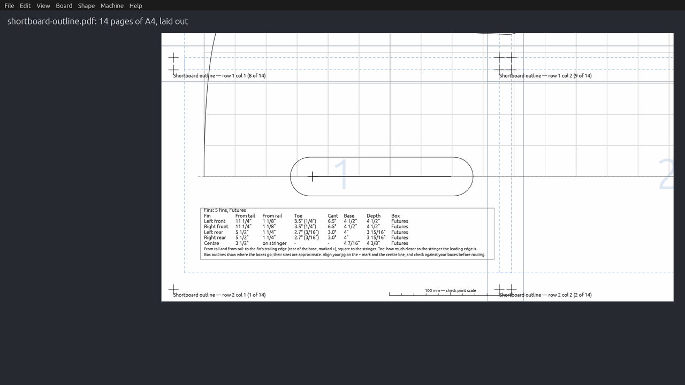
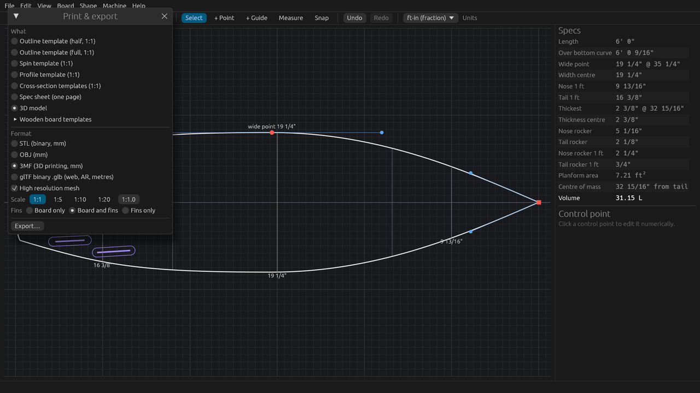

# Tutorial 3: Fins and print templates

Place a fin setup in real fin boxes, fine-tune each fin, shape it or pick a real fin model, check the fins in the
outline and in 3D, then print the outline template at full size with the fin boxes and a table of their measurements,
and export the 3D model with its fins. About 20 minutes, or watch the 4.5-minute video (`SurfCraft-tutorial-03-fins-and-print.mp4` on the
[Releases page](https://github.com/sseveur/surfcraft/releases)).

The tutorial uses the built-in 6'0" shortboard that SurfCraft opens with. The screenshots use feet and inches; every
value can also be typed in centimetres (`47cm`) or millimetres.

## 1. Choose a fin setup

1. Open the **Outline** tab and zoom in on the tail (scroll at the pointer; drag with the right button to pan).
2. **Board > Fins…** opens the Fins window. Drag it by its title bar to where it does not hide the tail (here to the
   right).
3. Choose a **Setup**: Single, Twin, Twin + 1 (twin + stabiliser), Thruster, Quad, 2+1 (side bites + US box single) or 5 fins.
4. Choose a **Box system**: FCS I, FCS II, Futures, US box (single) for a longboard centre fin, or None (position
   only).
5. Click **Apply preset**. The fins are placed at standard positions for this board's length and outline, as one undo
   step.

The positions come from published placement charts (Lundquist, the McKee table, Fiberglass Hawaii and the FCS II
install guide), scaled to the board's length. On a 6'0" thruster the side fins are 11" from the tail and 1 1/4" from
the rail, with 1/4" of toe (3.28°) and 6.5° of cant, and the centre fin is 3 1/2" from the tail.
[docs/fins.md](../fins.md) lists every number with its source, including where the sources disagree.

**Quad** puts the rear fins 5 1/2" from the tail. **5 fins** combines the thruster and quad boxes, so the board can be
ridden either way with the same boxes.

Each fin also gets a typical size for its role, for example 4.45" × 4.55" (base × depth) for thruster side fins,
3.95" × 4.05" for quad rears, 5.65" × 5.35" for twins and 3.25" × 3.3" for a twin's stabiliser (the medians of the
real fins in the fin catalogue, see section 4).

"2+1" means two things in surf shops. **Twin + 1 (twin + stabiliser)** is the shortboard one: two large twins and a
small trailer, all in FCS or Futures boxes. **2+1 (side bites + US box single)** is the longboard and mid-length one:
small side bites with a big single fin in a US box.

## 2. Box systems

The box system sets the footprint drawn around each fin:

- **FCS I**: two round plugs per fin (28.6 mm holes, 53 mm apart).
- **FCS II**: one plug per fin, drawn as a 110 x 37.5 mm envelope that encloses the plug.
- **Futures**: one long box, 5 7/8" x 1 1/4" (149.8 x 31.8 mm) with round ends.
- **US box**: a 10 1/2" longboard box for a single or a 2+1 centre fin.

Each fin also has its own **Box** column in the table, so a setup can mix systems (for example FCS II side fins with a
US box in the centre).

## 3. Edit the fins in the table

Each fin has a row:

| Column | Meaning |
|---|---|
| **From tail** | Tail to the fin's trailing edge (the rear of the fin base), along the stringer |
| **From rail** | Rail to the trailing edge, square to the stringer (side fins only) |
| **Toe (°)** | The leading edge turned towards the stringer, in degrees |
| **Cant (°)** | The tip tilted out towards the rail, in degrees |
| **Base** | Length of the fin base |
| **Depth** | Fin depth below the bottom |
| **Box** | The box system of this fin |

Click a field, type a value and press Enter. With **Mirror edits to the other side** ticked, the fin on the other
side follows. In the tutorial the front fins of a 5-fin Futures setup go to `11 1/4"` from the tail and `1 1/8"` from
the rail, with `3.5` degrees of toe and `7` degrees of cant. A side fin keeps its distance from the rail when you move
it along the board. Each edit is one undo step.

**Remove fins** takes all fins off the board.

## 4. Shape the fins, or use a real fin model

Below the table, **Fin shape (3D model and export)** sets the outline and foil of one fin (choose it in **Fin**; with
**Mirror edits** the other side follows). The shape is used by the 3D view and the 3D export, not by the templates.

- **Template**: Raked (swept, small round tip), Upright (wide round tip), Square tip, Pointed, or Keel.
- **Rake**: how far the tip reaches behind the rear of the base.
- **Tip width**: from 0 (pointed) to wider than the base (hatchet and cutaway fins).
- **Tip rounding**: from 0 % (square-cut) to 100 % (fully round).
- **Fullness**: how long the leading edge stays forward; a fuller fin has more area.
- **Thickness** at the root, and **Foil**: 50/50, 80/20 or flat inside (a centre fin is always symmetric).
- **Area**: type a fin maker's published area and the fullness changes to match it.
- **Use this shape on every fin** copies it to all fins, each keeping its own base and depth.

The side view on the right shows the fin to scale, with its base, depth and area.

**Fin models (FCS, Futures, Firewire)** lists 443 fin sets with the specs their makers publish: base, depth, area,
sweep, foil and cant. They are built into SurfCraft and work offline.

1. Open **Fin models** and type in **Search**: words match the start of the model's words, so `christenson 5 m`
   finds the Christenson 5-Fin M, and `performer m` finds the Performer M but not the XS. **Only Futures** (or your box
   system) hides sets for other boxes.
2. Click a set to see its fins, one row per role (side, centre, rear, front, or all fins the same). **Maker's page**
   opens the product page the numbers come from.
3. Click **Use ...**. Each fin takes the fin of its place in the set (the rear pair takes the rear fins), with its
   base, depth, foil and published cant, and an outline fitted to the published area and sweep. The positions stay.
   Without fins on the board, the set's setup is placed first.

A fin only takes a fin that fits its box: a US box single only goes in a US box, and an FCS or Futures fin only in an
FCS or Futures box. A 2+1 can take side bites from one set (for example the Skindog Side Byte) and its centre from a
US box single. Fins a set has nothing for are left as they are, and the window says which.

The outlines match the published numbers, not the makers' exact templates. [docs/fins.md](../fins.md) lists the
sources and the published data that looks doubtful.

## 5. Check the fins in the outline and in 3D

The outline view draws each fin base to scale, turned by its toe, with its box footprint around it. Zoom in to check
the distances; press **F** to fit the whole board again. **View > Fins** hides or shows them.

The **3D** tab shows the fins in blue under the board. Drag to turn the board over and look at the bottom.

## 6. Print the outline template

**File > Print & export…** (Ctrl+P, Cmd+P on a Mac):

1. Under **What**, choose **Outline template (half, 1:1)**. You trace it on the blank, flip it over the stringer line
   and trace the other side. **Outline template (full, 1:1)** prints both sides (twice as many pages).
2. Under **Format**, choose **PDF (print, tiled pages)**. **SVG** gives the template on one sheet at 1:1, and **DXF**
   is for CNC routers and laser cutters (for example to cut a template from hardboard).
3. Choose the **Paper** (A4 here) and the **Overlap** between pages (10 mm). The window says how many pages it takes:
   **14 page(s)** for this board on A4.
4. Click **Export…** and choose where to save the file.

With fins on the board, the outline template has the fin boxes, a **+** at each fin's trailing edge, the stringer
line, and a table of the fin positions.

The PDF splits the 1:1 drawing over the pages. Each page has its row and column ("row 2 col 1 (1 of 14)") and a cross
at each corner of the printable area: overlap the pages so the crosses line up, and tape them together.

Page 1 holds the tail, the table of fin positions and a **100 mm check bar**.

The fin table gives, for every fin, the distance from the tail and from the rail, the toe (in degrees and as a
distance, for example 3.5° (1/4")), the cant, the base, the depth and the box.

## 7. Export the 3D model with its fins

In **File > Print & export…**, **3D model** exports the board as STL, OBJ, 3MF or glTF, at full size or as a 1:5 or
1:10 scale model. With fins on the board, choose **Board only**, **Board and fins**, or **Fins only**. Each fin is a
separate closed solid sunk 3 mm into the bottom: slicers for 3D printing join them to the board, and for a flow
simulation you can join them first (a boolean union in your CAD or mesh tool) if your tool needs one solid.

## 8. Before you cut

- Print at **100% / actual size** (turn off "fit to page" in the print dialog), then **measure the 100 mm bar**. If it
  is not 100 mm, fix the printer settings and print again.
- **Check the fin boxes against a real box, or your jig, before routing.** The manufacturers do not publish most box
  footprints, so some sizes in SurfCraft come from shapers' measurements and are approximate. FCS and Futures expect
  their boxes to be routed with their own jigs: set the jig on the **+** mark (the fin's trailing edge) and the centre
  line. [docs/fins.md](../fins.md) lists each size, its source and which ones are approximate.

## Next

[Tutorial 4: fit in a blank and cut it on a CNC](04-blank-and-cnc.md): choosing a foam blank, Auto fit, toolpaths and G-code.
Back to [Tutorial 2: rocker and cross-sections](02-rocker-and-sections.md).
