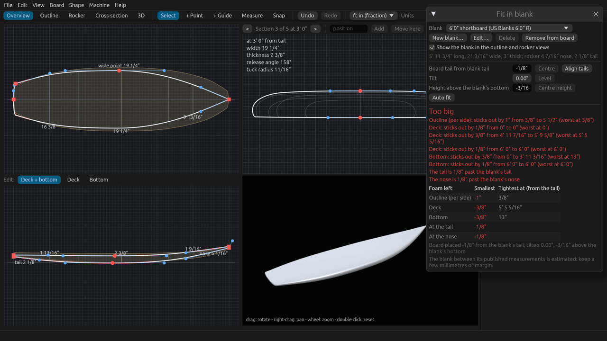
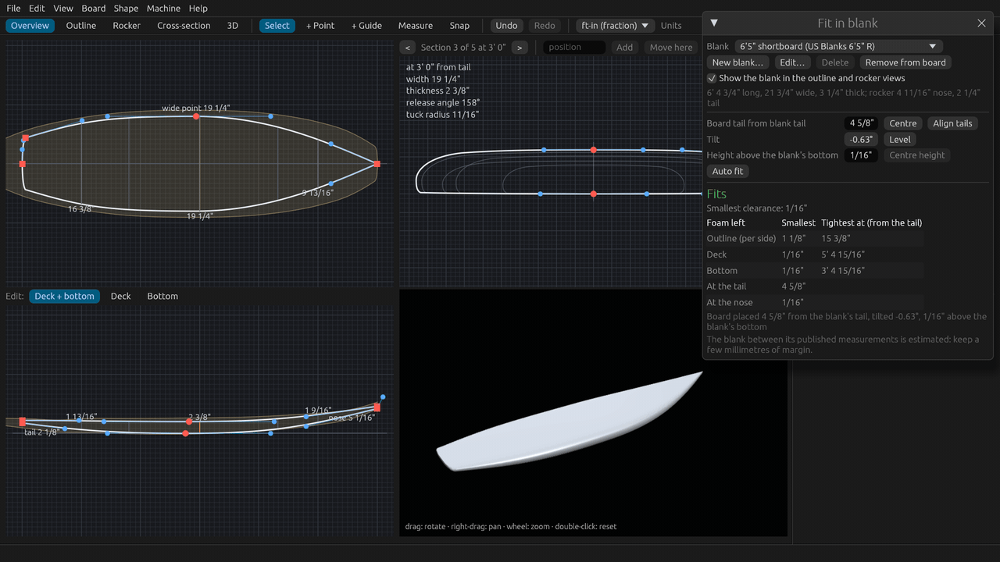
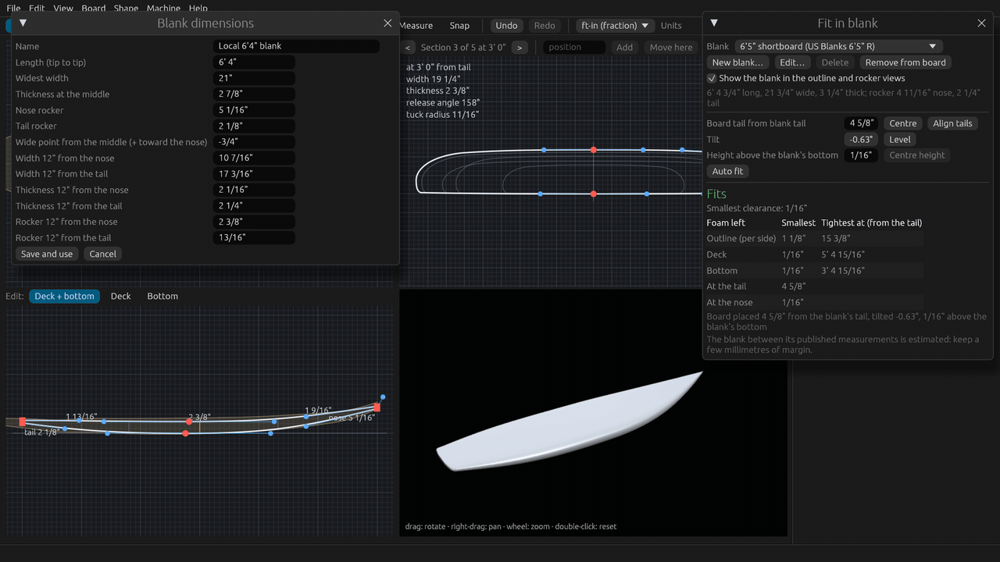
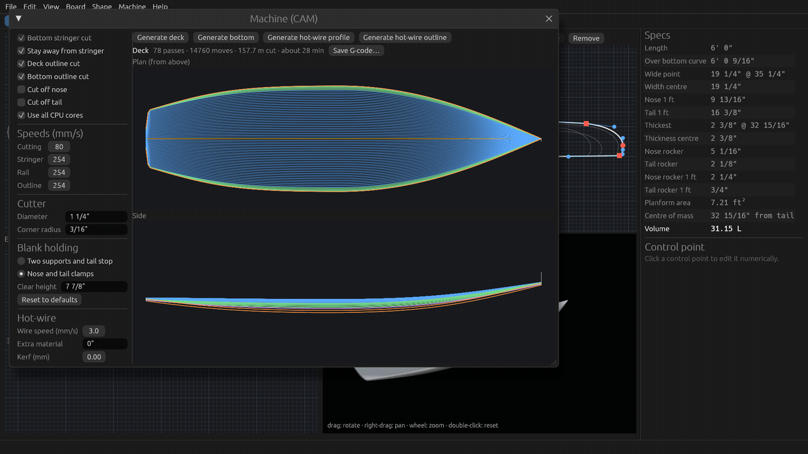
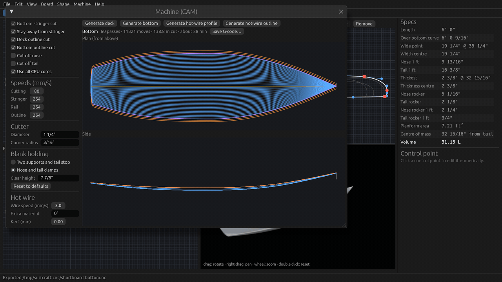

# Tutorial 4: Fit in a blank and cut it on a CNC

Check that your board fits inside a foam blank before you buy it, enter a blank of your own, then make the CNC
toolpaths for the deck and the bottom and save the G-code. About 10 minutes, or watch the 2-minute video
(`SurfCraft-tutorial-04-blank-and-cnc.mp4` on the [Releases page](https://github.com/sseveur/surfcraft/releases)).

The tutorial uses the built-in 6'0" shortboard and feet and inches; every length can also be typed in centimetres
(`47cm`) or millimetres.

## 1. Pick a blank

1. **Board > Fit in blank…** opens the Fit in blank window. It does not block the app: drag it by its title to the
   side (here over the specs) so the outline and rocker views stay in sight.
2. Open the **Blank** list. The **Library** has US Blanks and Surfblanks Australia blanks from their published
   drawings, and a few generic estimates; your own blanks are under **My blanks**.
3. Pick **6'0" shortboard (US Blanks 6'0" R)**.

The blank is drawn behind the board in the outline and rocker views (untick **Show the blank in the outline and
rocker views** to hide it). This one is too small:

- **Too big** in red, with what sticks out and where: the outline is wider than the blank near the tail, the deck
  and the bottom touch, and the board is 1/8" longer than the blank at each end.
- The places where the board sticks out are red on the curves in the outline and rocker views.
- The **Foam left** table shows negative values in red.

## 2. A better blank and Auto fit

Pick a longer blank, **6'5" shortboard (US Blanks 6'5" R)**. Centred in it, the board still touches: the blank's
rocker is not the board's rocker. You can move the board in the blank yourself:

- **Board tail from blank tail**: slide it along the blank (**Centre** for the same spare foam at both ends,
  **Align tails** to start at the blank's tail).
- **Tilt**: rotate it in the rocker view (positive lifts the nose); **Level** sets it back to 0°.
- **Height above the blank's bottom**; **Centre height** for the same smallest foam above and below.

Or click **Auto fit**: it searches the shift along the blank and the tilt (up to 6° each way) that leave the most
foam everywhere. Here the board ends up 4 5/8" from the blank's tail, tilted -0.63°, and **Fits**.

The table gives the smallest foam left around the **Outline (per side)**, above the **Deck** and under the
**Bottom**, each with where it is tightest (from the board's tail), and the spare length **At the tail** and **At the
nose**.

The blank between its published measurements is estimated, and blanks vary from one pour to the next: keep a few
millimetres of margin. Off the stringer the check assumes the blank's full thickness reaches the board's rail, so a
very full rail right at the blank's edge needs a look on the real blank. The blank and its placement are saved in
the board file, and each choice is one undo step.

## 3. Your own blank

Your blank is not in the list? Click **New blank…**. The form starts from the board's size with a little foam all
round; type the numbers from the maker's drawing (or from the blank on your rack), in inches, cm or mm:

- **Name**, **Length (tip to tip)**, **Widest width**, **Thickness at the middle**, **Nose rocker**, **Tail rocker**
  and **Wide point from the middle** (positive toward the nose).
- Optional: the width, thickness and rocker **12" from the nose** and **from the tail**. Leave a field empty when
  you do not have it; typical proportions fill in.

In the tutorial the blank is called `Local 6'4" blank`, `6'4"` long and `21"` wide.

**Save and use** puts the blank on the board and keeps it under **My blanks** for your next boards (**Edit…** changes
it, **Delete** removes it from your list; the board keeps its copy). Click **Auto fit** again to place the board in
it.

**Surfblanks Australia drawings** label every station by its distance from the tail, measured along the curved
bottom: their nose stations are 12" and 24" from the nose along the curve, while "Max length" is the straight
length. Type the max length as the length, and the values of the station 12" from the nose as **12" from the
nose**. US Blanks measure each station from its own tip. [The blanks page](../blanks.md) has the details and the
sources of the library.

## 4. Machine settings

**Machine > Machine (CAM)…** opens the CNC window. On the left, the settings (scroll down for the cutter and
holding):

- **Toolpaths**: surface splits or width splits, the **Lengthwise step**, the number of deck, rail and clean-up
  cuts and their angles, stringer and outline cuts, nose and tail cut-offs.
- **Speeds (mm/s)** for cutting, the stringer, the rails and the outline.
- **Cutter**: the **Diameter** and **Corner radius** of your bullnose cutter. The tutorial types `1 1/4"`.
- **Blank holding**: **Two supports and tail stop**, or **Nose and tail clamps**, and the **Clear height** the
  cutter rises to between passes. Pick what your machine uses: it sets where the board sits on the machine, and
  the toolpaths keep away from the supports or clamps.
- **Reset to defaults** if you get lost.

## 5. Generate the toolpaths

Click **Generate deck**. The toolpaths are computed in the background (a spinner turns meanwhile), then drawn
**from above** and **from the side**, coloured by pass: blue regular passes, green rails, yellow stringer, violet
outline, orange clean-up.

The line above the preview sums up the program: the number of passes and moves, the length of cut, and the
machining time (here about 28 minutes for the deck). The time is the cut length at the programmed speeds, without
the machine's accelerations, so the real cut takes a little longer. If you change the board afterwards, the line
says **board changed since: regenerate**.

## 6. Save the G-code

**Save G-code…** writes the program (`<board>-deck.nc` by default; millimetres, `G21`). Then **Generate bottom** and
save it too: one program per side. The tutorial saves both in a temporary folder; the status bar shows where.

The **Hot-wire profile** and **Hot-wire outline** buttons make 2D programs for a hot-wire foam cutter instead (wire
speed, extra material and kerf at the bottom of the settings).

## 7. Check before you cut

Before you cut foam, open each program in your machine's simulator or control software and check:

- the moves follow the board, with no cut through the holding (supports, clamps or tail stop);
- the program zero is where your machine expects it (the holding setting decides where the board sits on the
  machine);
- the clear height clears everything between passes.

A first cut in cheap foam, or an air cut above the blank, is a good habit on a new setup.

## Next

[Tutorial 5: design by numbers and copying a board](05-numbers-and-measurements.md).
