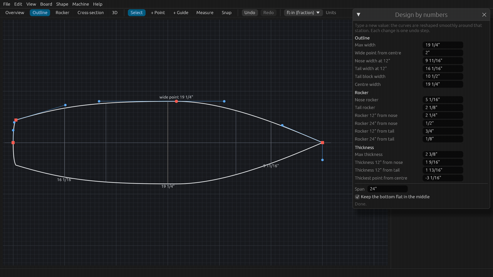
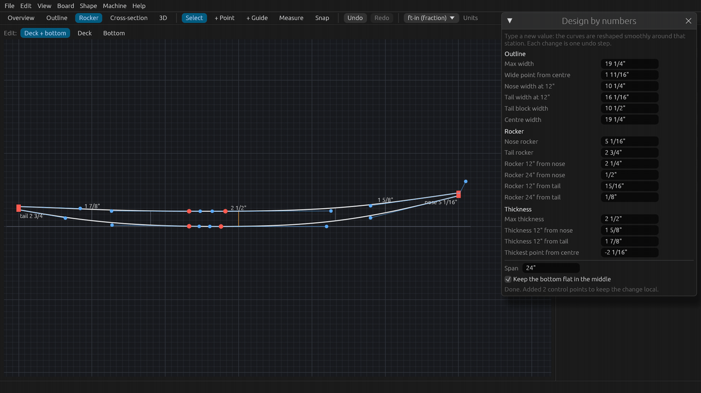
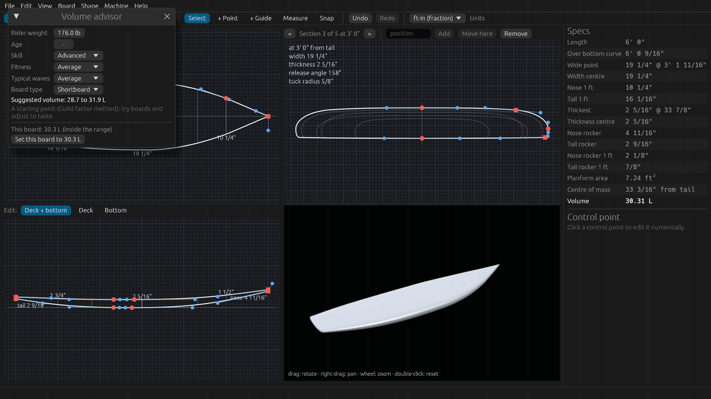
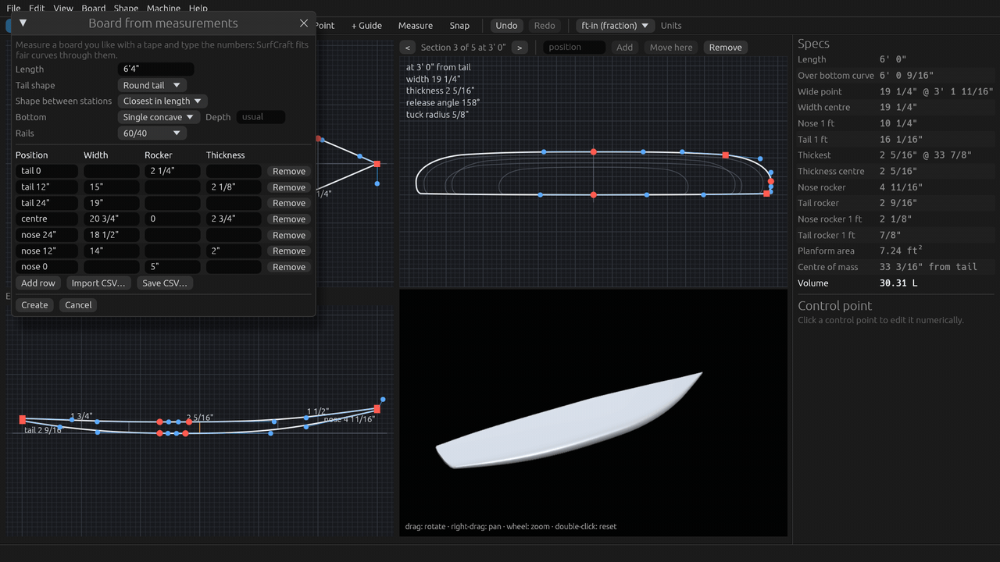
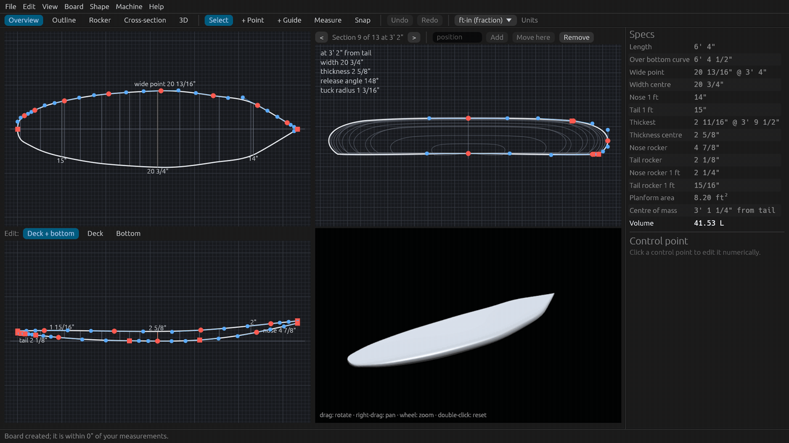

# Tutorial 5: Design by numbers and copying a board

Type a board's key dimensions instead of dragging points, check its volume for a rider, then rebuild a board you
measured with a tape. About 10 minutes, or watch the 2-minute video
(`SurfCraft-tutorial-05-numbers-and-measurements.mp4` on the
[Releases page](https://github.com/sseveur/surfcraft/releases)).

The tutorial starts from the built-in 6'0" shortboard and uses feet and inches; every value can also be typed in
centimetres (`47cm`) or millimetres.

## 1. Design by numbers

**Board > Design by numbers…** lists the dimensions shapers talk about, measured on the open board:

- **Outline**: max width, wide point from centre (positive toward the nose), nose and tail width at 12", tail block
  width (square, squash and swallow tails), centre width. With metric units the widths 30 cm from each end are
  listed too.
- **Rocker**: nose and tail rocker, and the rocker 12" and 24" from each end.
- **Thickness**: max thickness, thickness 12" from the nose and from the tail, thickest point from centre.

The window does not block the app: drag it by its title over the specs so the curves stay in sight. Click a value,
type the new one and press Enter. The curves are reshaped smoothly around that station, and the window shows the
new numbers. In the tutorial, in the **Outline** tab:

1. **Wide point from centre** `2"` (it was 3/4" behind the centre): the widest point moves forward and the outline
   follows.
2. **Nose width at 12"** `10 1/4"` (from 9 13/16"): a little more nose. Moving the nose also moves the wide point a
   little, which the window shows.

Then in the **Rocker** tab:

3. **Max thickness** `2 1/2"` (from 2 3/8").
4. **Tail rocker** `2 3/4"` (from 2 1/8"): more tail lift.

Under the list:

- **Span**: how far a width or thickness change spreads each side of the station (a third of the board by
  default). A shorter span keeps the change local; a longer one spreads it.
- **Keep the bottom flat in the middle**: rocker changes leave the flat part of the bottom alone.
- The message line says what happened: **Done.**, or that a control point was added to keep the change local. When
  a change makes a curve bend both ways (an S-bend), it says so in orange, for example *The Outline now bends both
  ways somewhere; check it for fairness*: look at the curve, try a smaller change or a longer span, or undo. A value
  the board cannot take is refused with the reason, and nothing changes.

Each change is one undo step: **Undo** (Ctrl+Z, Cmd+Z on a Mac) takes them back one at a time, **Redo** brings them
back.

## 2. Volume advisor

Back in the **Overview** tab, press **F** to fit the views again. **Board > Volume advisor…** suggests a volume for
a rider and compares it with the open board:

1. Click **Rider weight** and type the weight (here `176`; pounds with feet and inches, kilograms in metric), or drag
   the value sideways. The age is optional.
2. Set the **Skill**, **Fitness**, **Typical waves** and **Board type** (here **Advanced**).
3. The window shows the **Suggested volume** (28.7 to 31.9 L here) and where **This board** is: after the changes
   above it is 32.5 L, above the range.
4. **Set this board to 30.3 L** changes the thickness to reach the middle of the range, as one undo step.

The suggestion is a starting point (the Guild factor method), not a rule;
[the volume advisor page](../volume-advisor.md) explains it.

## 3. Copying a board: New from measurements

To copy a board you like, measure it with a tape and type what you read in **File > New from measurements…**:

- **Length**: the straight length, tip to tip (`6'4"`).
- **Tail shape**: pin, round, squash, square or swallow (here **Round tail**).
- **Shape between stations**: the template whose shape and cross-sections fill in between your numbers
  (**Closest in length** by default).
- **Bottom**: as the template, flat, single concave, double concave or vee, with an optional **Depth** (empty: the
  usual depth). The tutorial picks **Single concave**.
- **Rails**: as the template, 50/50, 60/40, 70/30 or 80/20 (here **60/40**).

The table has one row per station. **Position** is the distance from the tail (`36"`), or `tail 12"`, `nose 12"`,
`centre`. The `tail 0` row is the tail end (its width is the tail block width of a square, squash or swallow tail;
its rocker is the tail lift) and `nose 0` the nose tip (nose lift). **Rocker** is the height of the bottom above a
flat surface, so the lowest point is `0`. Leave a cell empty when you did not measure it. **Add row** adds a station
(every foot, if you like), **Remove** deletes one.

The tutorial types:

| Position | Width | Rocker | Thickness |
|---|---|---|---|
| tail 0 | | 2 1/4" | |
| tail 12" | 15" | | 2 1/8" |
| tail 24" | 19" | | |
| centre | 20 3/4" | 0 | 2 3/4" |
| nose 24" | 18 1/2" | | |
| nose 12" | 14" | | 2" |
| nose 0 | | 5" | |

You need the length, at least two widths and one thickness; the window says what is missing or cannot be read.

**Save CSV…** keeps the table for later (or to share), and **Import CSV…** reads one back, for instance one typed
in a spreadsheet: columns `position`, `width`, `rocker`, `thickness` (in any order, named in a header line), plus
optional `length`, `tail`, `template`, `bottom`, `bottom depth` and `rail` lines, comma or semicolon separated. The
easiest start is to save a table and edit it. Bare numbers are in the display unit.

## 4. Create

Click **Create**. When the open board has unsaved changes, SurfCraft asks first (**Save**, **Don't save** or
**Cancel**); the tutorial does not keep its changed shortboard. SurfCraft fits fair curves through your numbers and
the status bar says how close it got (*Board created; it is within 0" of your measurements*: closer than the 1/16"
the display shows).

Check the result in the specs and the views: 6'4" long, 20 3/4" wide in the middle, 15" and 14" a foot from the
tail and the nose. The bottom shape and the rails are cut after the fit, keeping the rail line, so a concave
makes the stringer thinner and raises the stringer rocker by about its depth: here the specs show 2 5/8" thick and
4 7/8" of nose rocker for the 2 3/4" and 5" typed. Then fine-tune the board with Design by numbers, and save it.

## Next

Tutorial 6: asymmetric boards (coming). All tutorials: [README](README.md).
