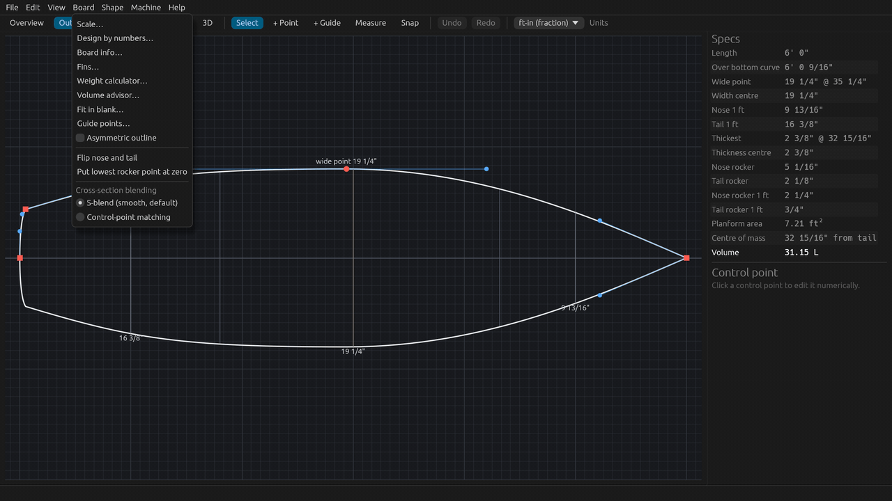
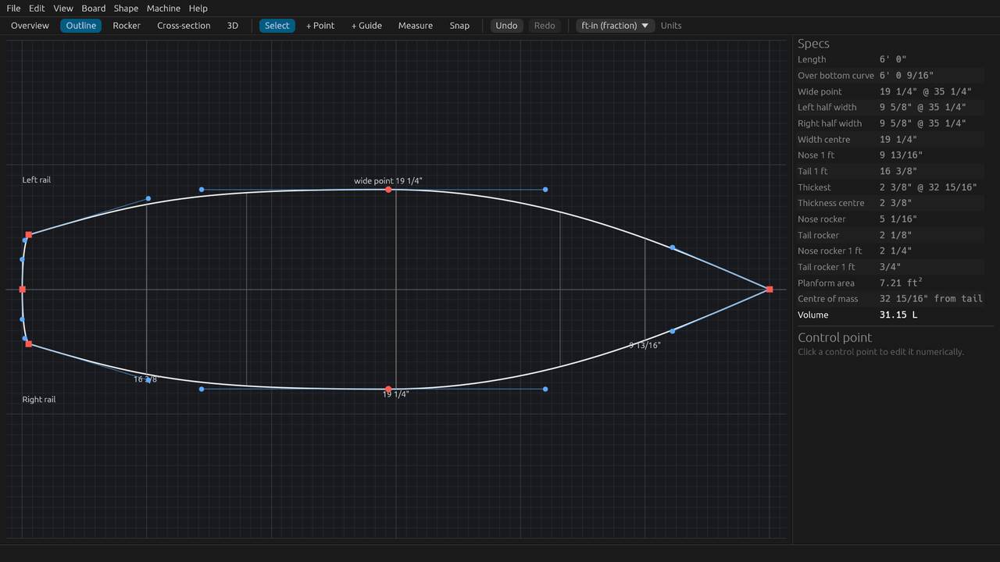
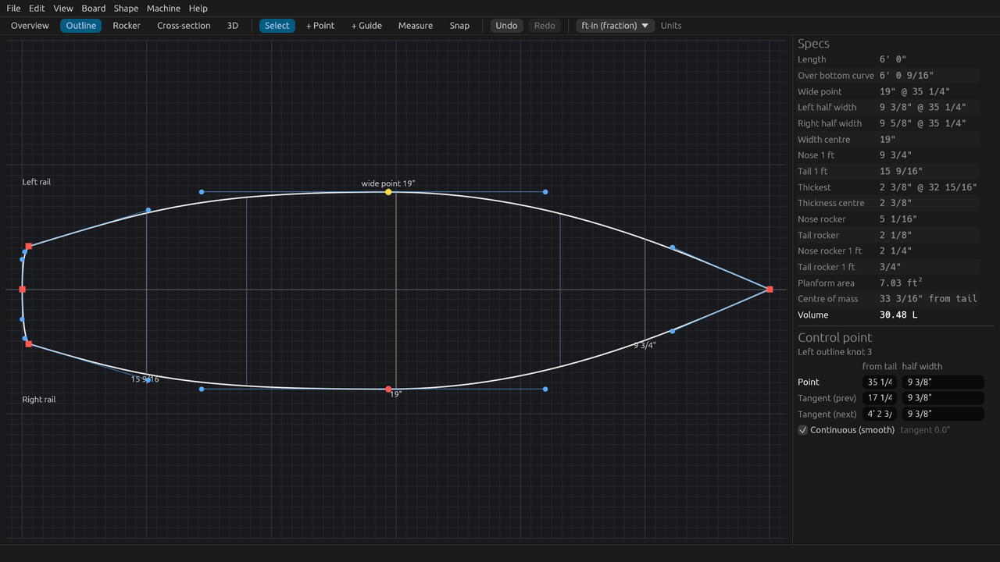
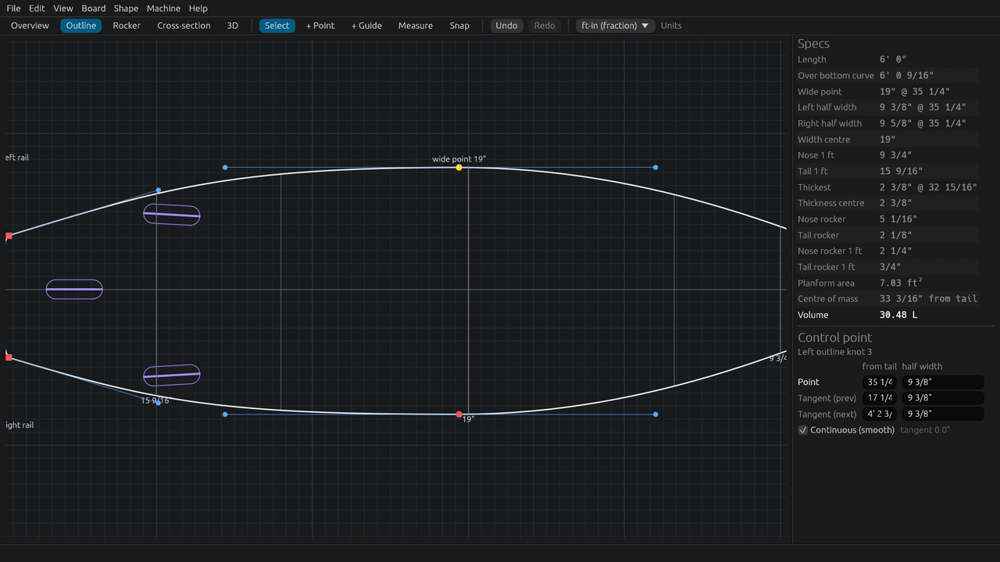
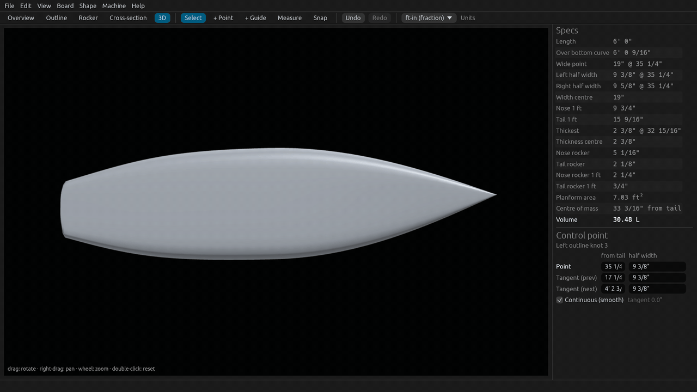
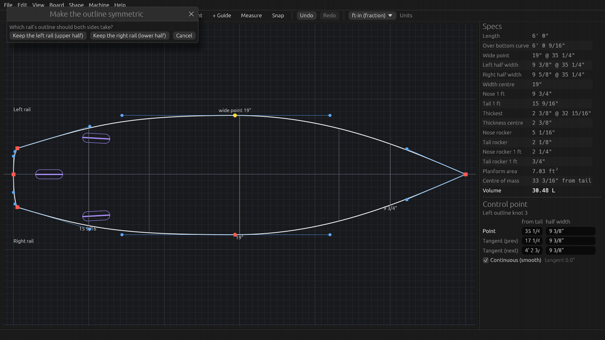

# Tutorial 6: Asymmetric boards

Give each rail its own outline: turn on **Board > Asymmetric outline**, learn which rail is drawn where, reshape one
rail, read the per-rail widths, check the board in 3D, place fins that follow each rail, and go back to a symmetric
board. About 10 minutes, or watch the 1.5-minute video (`SurfCraft-tutorial-06-asymmetric.mp4` on the
[Releases page](https://github.com/sseveur/surfcraft/releases)).

Why asymmetric? A surfer turns differently on the toes (frontside) and on the heels (backside). Some shapers give the
two rails different curves to suit each turn. A common idea is a straighter, fuller toe-side rail for long drawn-out
turns and a curvier heel-side rail, often with a narrower tail, for tighter turns off the back foot. SurfCraft does
not decide this for you: it lets you draw each rail and shows you the numbers.

## 1. Turn it on

1. Open the **Outline** tab.
2. **Board > Asymmetric outline**. The tick shows the board is asymmetric.

The second rail starts as a copy of the first, so the board, its specs and its volume do not change yet. Turning
it on is one undo step.

## 2. Which rail is which

"Left" and "right" are the **rider's**, standing on the deck and facing the nose. The Outline view shows the deck
from above with the nose to the right, so:

- the **left rail** is drawn **above** the stringer,
- the **right rail** is drawn **below** it.

Both rails now have their own control points, and the view labels them **Left rail** and **Right rail**.

Which one is the toe side depends on the stance. A **regular-foot** surfer (left foot forward) has the toes on the
**right** rail and the heels on the left rail. For a **goofy-foot** surfer it is the other way round.

## 3. Reshape one rail

Click and drag points as usual (see [Tutorial 1](01-first-board.md)). A point belongs to the rail on its side of the
stringer, and only that rail moves. In the video, for a regular-foot surfer, the heel-side (left, upper) rail gets:

- its **tail corner** pulled in, for a narrower heel-side tail,
- its **wide point** drawn in a little.

The right (toe-side) rail stays as it was. The **Control point** panel names the rail: *Left outline* or
*Right outline*. Every drag is one undo step, and typed values work the same way on both rails.

## 4. Per-rail widths

On an asymmetric board the **Specs** panel adds two rows under **Wide point**:

- **Left half width**: the widest point of the left rail, from the stringer, and where it is from the tail,
- **Right half width**: the same for the right rail.

**Wide point** is the total width (left half + right half) at its widest. The **Volume**, area and centre of mass
add the two halves, so the volume is the average of the two symmetric boards you would get by mirroring each rail.
Cross-sections stay symmetric shapes; on each side they are scaled to that rail's width.

## 5. Fins follow each rail

**Board > Fins…**, choose a **Setup** (for example **Thruster**) and press **Apply preset**. Each side fin is
placed from **its own rail**: both side fins are the same distance in from the rail edge, so on a board with a
narrower heel side they sit at different distances from the stringer. The **From rail** column of the Fins window
is measured from each fin's own rail.

## 6. In 3D

The **3D** tab shows each half of the board following its own rail. Drag to turn the board (drag down for a view
from straight above, nose to the right, left rail at the top as in the Outline view); drag up to turn it over and
see the fins under the tail. Scroll to zoom, double-click to reset the view.

## 7. Back to symmetric

Untick **Board > Asymmetric outline**. SurfCraft asks which rail both sides should take:

- **Keep the left rail (upper half)**,
- **Keep the right rail (lower half)**,
- **Cancel** leaves the board asymmetric.

The other rail's outline is replaced, so this is a real change to the board, but it is one undo step: **Undo** (or
Ctrl+Z, Cmd+Z on a Mac) brings both rails back.

## 8. Saving, and BoardCAD

Asymmetric boards are saved as ordinary `.brd` files. The right rail is stored as the normal outline and the left
rail in an extra block that BoardCAD skips. So **BoardCAD opens the file too, but shows a symmetric board made of
the right rail, mirrored**. If you save the file from BoardCAD, the left rail is lost: keep editing asymmetric boards
in SurfCraft. Exports (3D models, templates, toolpaths) use both rails.

## Next

[Tutorial 7: reporting a bug](07-reporting-a-bug.md): detailed logging and Help > Report a bug.
