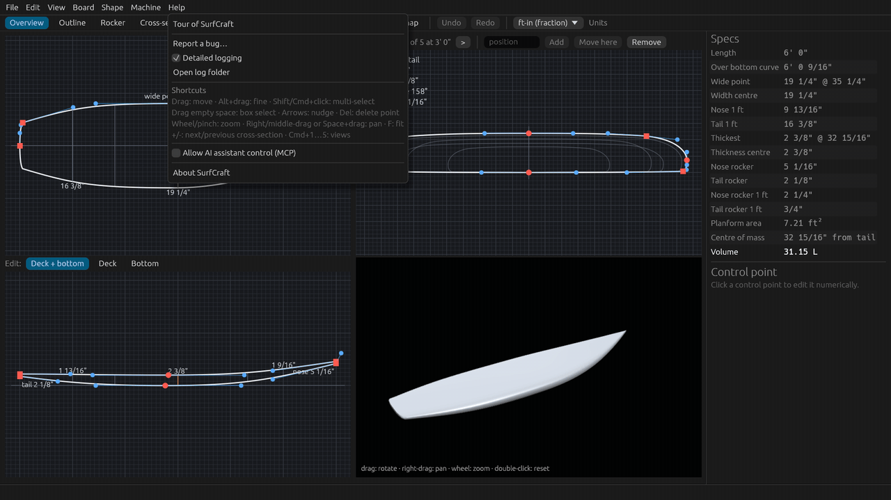
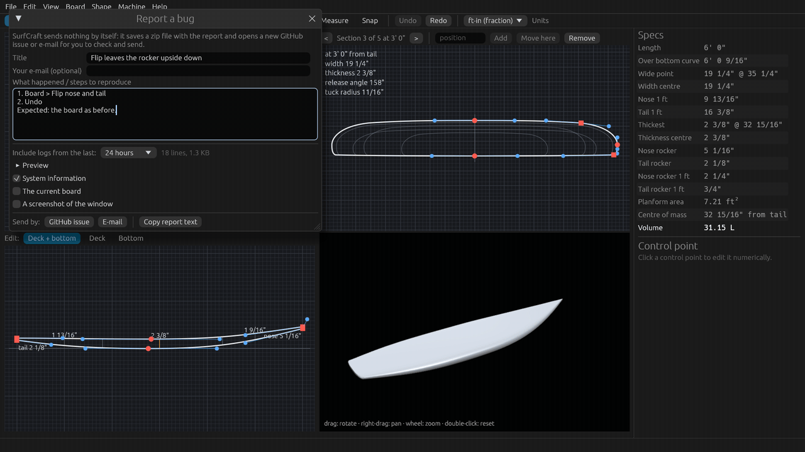
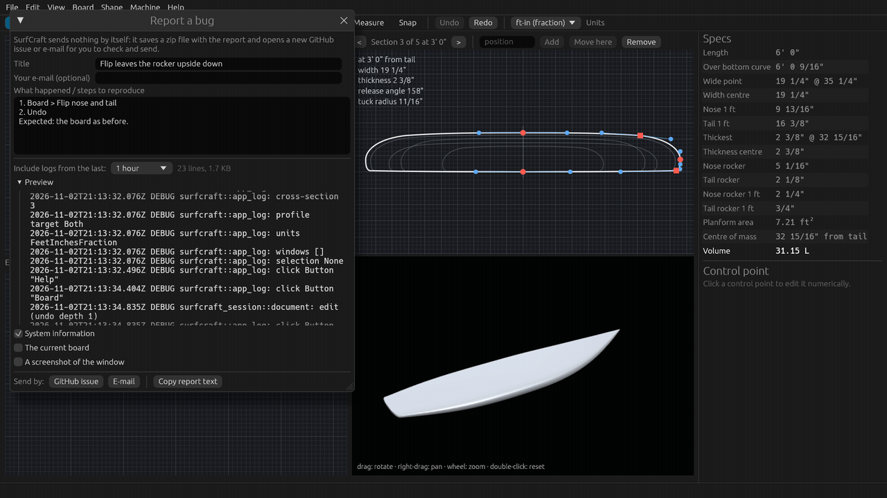
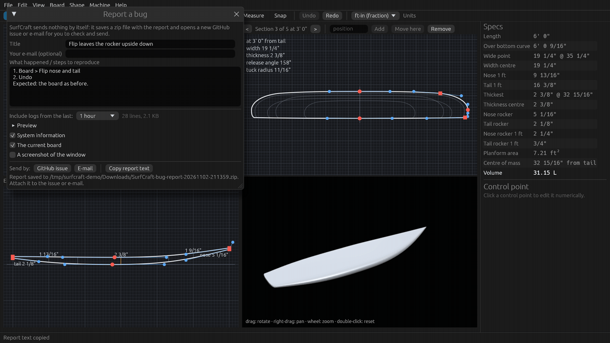

# Tutorial 7: Reporting a bug

Something went wrong? A good report, with the log of what happened, is the fastest way to get it fixed. Turn on
detailed logging, make the problem happen again, then use **Help > Report a bug**. About 5 minutes, or watch the
1.5-minute video (`SurfCraft-tutorial-07-reporting-a-bug.mp4` on the
[Releases page](https://github.com/sseveur/surfcraft/releases)).

**SurfCraft sends nothing by itself.** It saves a zip file on your computer and opens a new GitHub issue in your
browser, or a new message in your mail program, for you to check, attach the zip to and send.

## 1. The log

SurfCraft keeps a log on your computer: one file per day (`surfcraft-YYYY-MM-DD.log`), kept for 14 days, then
deleted. Every line starts with the time. It records what the app does (files opened and saved, errors, crashes
with their details), and your home folder is written as `~`. On a Mac the files are in
`~/Library/Application Support/org.surfcraft.SurfCraft/logs`; on any system, **Help > Open log folder** opens the
folder for you.

## 2. Turn on detailed logging

**Help > Detailed logging**. With the tick on, the log also records every edit, undo and redo, every click (by the
button's or field's name, never what you type into a field), and each change of view, tool, units, selection or open
window. That is what lets someone follow exactly what you did.

The setting is kept when you quit, so turn it off again when you are done (it makes the log bigger, nothing else).

## 3. Make the problem happen again

Do what led to the bug once more, step by step, while detailed logging is on. In the video: **Board > Flip nose and
tail**, then **Undo**. If the app crashed, just start it again: the crash and its details are already in the log.

## 4. Help > Report a bug

The **Report a bug** window opens next to your board (it does not block the app, so you can keep it open while you
try things):

- **Title**: one short line, such as *Flip leaves the rocker upside down*.
- **Your e-mail (optional)**: only written into the report file, so we can ask you questions. GitHub issues are
  public; the e-mail is not put into the issue.
- **What happened / steps to reproduce**: what you did, what you expected and what happened instead.

## 5. Choose the log period and preview it

**Include logs from the last:** picks how far back the log goes: 1 hour, 6 hours, 24 hours (the default), 3 days,
7 days or All. Next to it you see how many lines and kilobytes that is. One hour is plenty for a bug you just made
happen; choose longer for something that happened yesterday.

Open **Preview** to read exactly the log text that will go into the report.

## 6. What else to include

- **System information** (ticked by default): SurfCraft version, operating system, graphics card, display scale,
  locale, language and units, the board's file name and whether it has unsaved changes.
- **The current board**: a copy of the open board as `board.brd`, with any unsaved changes. Your own file is not
  touched. Tick it when the bug depends on the board's shape.
- **A screenshot of the window**: taken when you press GitHub issue or E-mail.

## 7. Send it

- **Copy report text** puts the text of the report (title, description, your e-mail if you gave one, and the
  system information) on the clipboard, to paste into a forum post, a chat or a message of your own. The log is not
  in it: send `surfcraft-log.txt` from the zip, or a file from the log folder, with it.
- **GitHub issue** and **E-mail** first save a zip file, named like `SurfCraft-bug-report-20261103-091500.zip`, in
  your **Downloads** folder (or on the Desktop when there is no Downloads folder) and show it in Finder or
  Explorer. Then:
  - **GitHub issue** opens a new issue on github.com in your browser, with the title, your description, the system
    information and a reminder to attach the zip. You need a (free) GitHub account to submit it.
  - **E-mail** opens a new message in your mail program, with the same text, addressed to the SurfCraft bug-report
    address.

  The window then says where the zip was saved.

The log, the board and the screenshot are only in the zip, never in the web address or the message text: **drag the
zip into the issue or attach it to the e-mail**, check everything, and send. Nothing is sent until you press the
button in your browser or mail program.

The zip holds `report.txt`, `surfcraft-log.txt` and, as you chose, `system-info.txt`, `board.brd` and
`screenshot.png`. You can open it and look before you send it.

## Next

Back to the [tutorial list](README.md).
